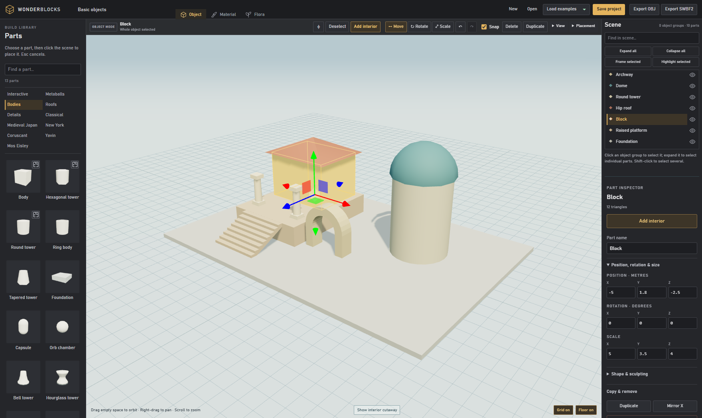
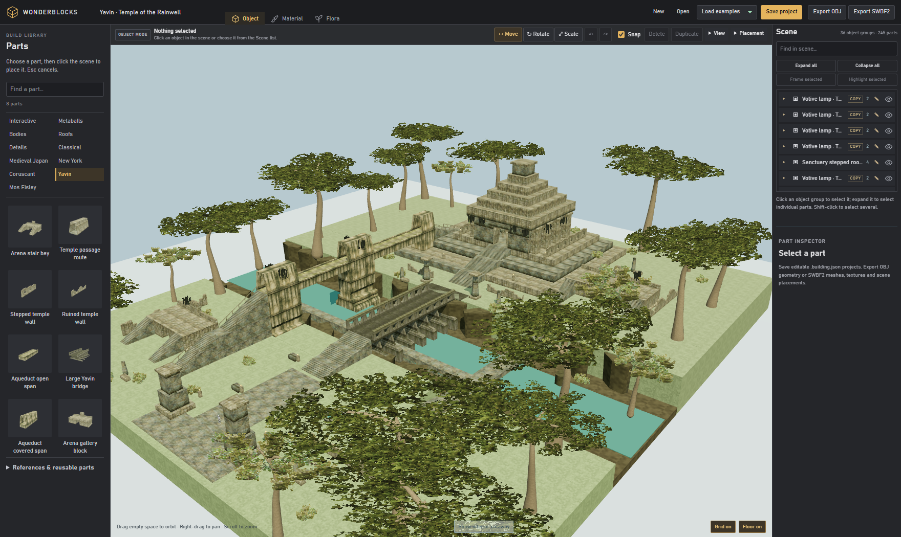
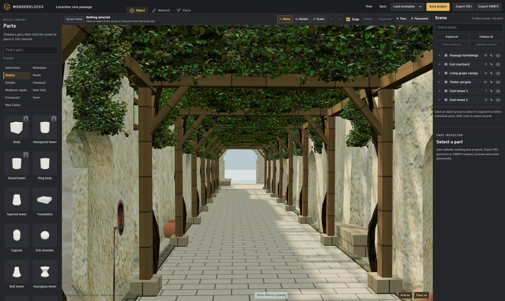

# WonderBlocks

A 3D scene and object builder for **Star Wars Battlefront II (2005)**.

- Build editable rooms, routes, platforms, and vegetation.
- Apply textures, group and copy objects, and explore scenes in walk mode.
- Save editable projects or export OBJ and SWBF2 assets and scene placements.

## Screenshots



| Yavin Rainwell | Levantine vine passage |
| --- | --- |
|  |  |

## Windows app

Download the installer or portable ZIP from [Releases](https://github.com/milehighguy-dev/WonderBlocks/releases).

Run the installer, or extract the **entire ZIP** and launch `Wonderblocks.exe`. Node.js and a separate browser are not required.

## Run from source with npm

Install **Node.js 24**, clone or download this repository, and run these commands in its folder:

```sh
npm install --omit=dev
npm start
```

Open [http://127.0.0.1:4178](http://127.0.0.1:4178) in a browser with WebGL enabled. After installing dependencies, Windows users can also double-click `Start.cmd` to launch it. Stop `npm start` with **Ctrl+C**; use `Stop.ps1` for a server launched by `Start.cmd`.

Both versions work offline after setup and use the same `.building.json` project files. Use **Save project** to keep a portable copy of your work.

## SWBF2 export

Exports contain source files for the PC Mod Tools; they still need to be compiled for the game. See the [export guide](docs/swbf2-export.md) for WorldEdit and world-folder setup.

Code is [MIT licensed](LICENSE). Third-party assets retain their original ownership.
