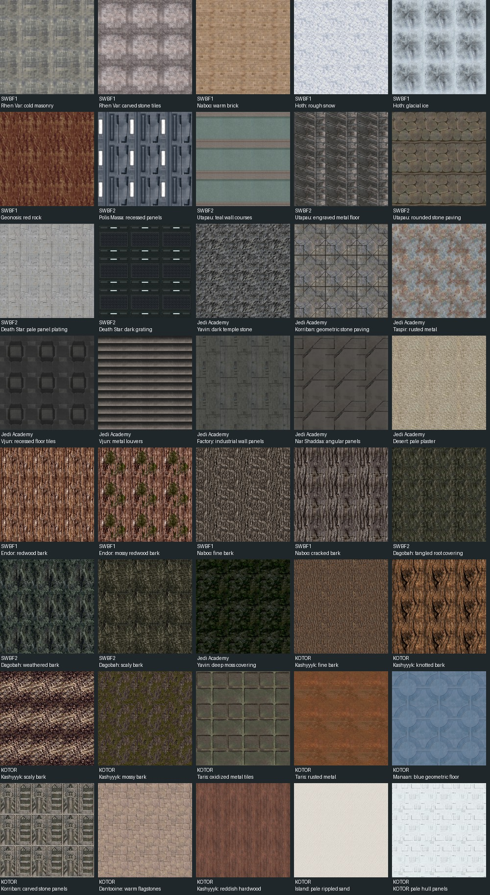
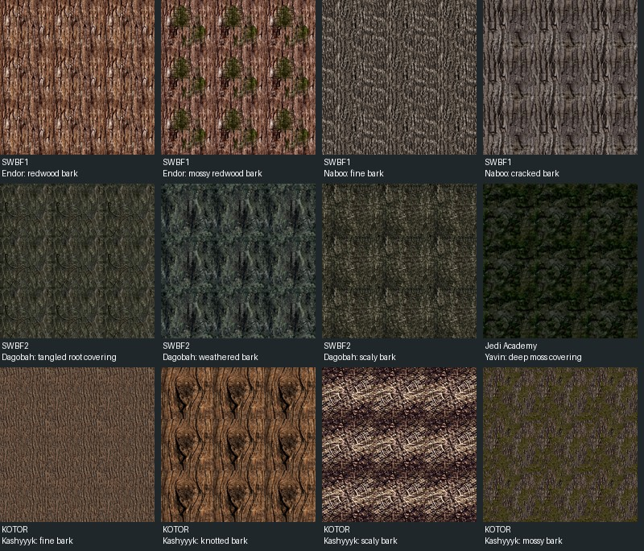
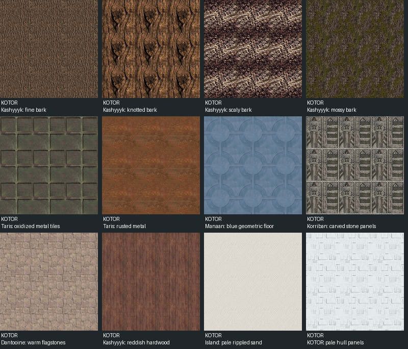

# Imported tiling surfaces

**Audience:** Contributors and coding agents. Historical research and asset notes, not a user guide; details may no longer match the current app.

The imported collection contains twenty-eight architectural/ground tiles and
twelve bark/root/moss coverings: SWBF1 (10), SWBF2 (9), Jedi Academy (9), and
KOTOR (12). They appear alongside the existing texture library.

Browse using the preview cards for **Urban**, **Tatooine**, **Rhen Var**,
**Yavin**, **Hoth**, **Naboo**, **Utapau**, **Korriban**, **Industrial**, **Flora**,
**Terrain**, **Classical**, **Medieval Japan**, **Highway**, and **General**.
Each card opens its textures; **Categories** returns to the cards. **All textures**
shows the full library, and **Find a texture** searches across every collection.
These groups combine matching textures from different source games. Browsing
categories does not paint or alter the scene.

Use **Use texture colors** to clear an object's existing tint. The usual texture
repeat control sets scale, and finishes use the existing save and export paths.

The selection covers cold and warm masonry, carved stone, snow, ice, red rock,
plaster, paving, industrial plating, grating, louvers, and rusted metal. No object
atlases, decals, signs, transparent effects, or isolated trim strips are included.

The full tile is resized to the library's existing 128×128 resolution. No atlas
cropping, edge blending, or mirror repetition is used. Every tile was reviewed
in a repeated grid, and opposite-edge differences were checked against normal
neighbouring-pixel differences. This measures discontinuities without requiring
natural noisy surfaces to have identical first and last pixels.

For a created tree, select it in Material mode, choose **Trunk & branches**, then
the **Flora** texture card. The texture repeat control changes bark scale without
changing the plant geometry or leaf material. Clear the bark tint with **Use
texture colors** to see the source colors.

The flora selection includes redwood, mossy redwood, fine and cracked Naboo bark,
tangled Dagobah roots, weathered and scaly swamp bark, deep Yavin moss, and
Kashyyyk fine, knotted, scaly and mossy bark.
Four flora sources contain a separate alpha channel; the manifest explicitly marks
them `opaqueRGB` because their complete RGB tiles are used as solid trunk
coverings. No leaf silhouettes or transparent foliage cards are imported here.

`assets/materials/tiling-sources.json` records source-relative paths, original
dimensions, SHA-256 hashes and seam measurements. `tools/import-tiling-textures.py`
rebuilds the embedded RGB data and review sheet from the local SWBF1 Mod Tools,
SWBF2 Mod Tools, unpacked Jedi Academy textures, and KOTOR's high-quality
`TexturePacks/swpc_tex_tpa.erf` archive. KOTOR records identify the named TPC
resource and hash that resource's original bytes, not the whole archive. The
read-only decoder follows the PC [TPC format](https://github.com/OpenKotOR/PyKotor/blob/master/wiki/TPC-File-Format.md),
decodes its first mip level and flips stored bottom-up rows into the importer's
top-down image convention. Normal maps, bump textures, and material masks are
excluded from color selection. Source files remain
unchanged. These are original game textures; the source games' rights apply.

The KOTOR selection has four barks plus Taris oxidized tiles and rusty metal,
Manaan geometric flooring, Korriban carved panels, Dantooine flagstones,
Kashyyyk hardwood, pale island sand and pale hull panels.

